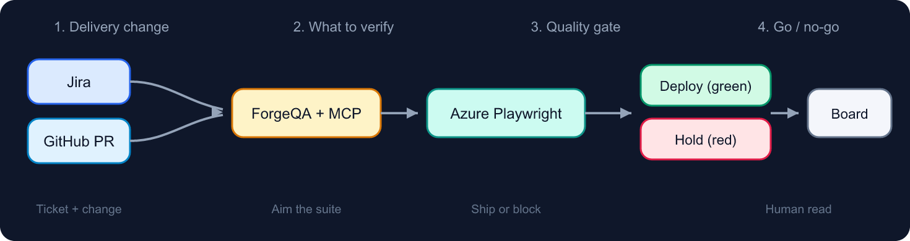

# 🚦 Release Gate Lab

A **Release Gate dashboard** plus a **lean Azure Pipeline** that only deploys to Vercel when a small Playwright smoke suite passes.

**Live demo:** https://release-gate-lab.vercel.app/

## Why this exists

Large test suites that nobody reviews become theater. This lab shows the opposite:

- A **tiny, trusted Playwright suite** (quality gate, not a bottleneck)
- **Human go/no-go** next to automation (checklist + auto risk brief)
- **Deploy only on pass** — and a safe way to demo the failure path

## Architecture idea

This lab is the **result board** for a bigger delivery loop. The full shape looks like this:

| Piece | Role |
|-------|------|
| **Jira** | System of record for the delivery ticket, acceptance criteria, and status humans trust |
| **GitHub PR** | The code change that implements that ticket |
| **ForgeQA + MCP** | AI layer that connects PR / codebase context to risk-ranked or suggested tests (what should run for *this* change) |
| **Azure + Playwright** | Lean quality gate that actually runs and decides ship vs hold |
| **This dashboard** | Where release owners read the **outcome** of that gate |

So the point is not “another CI badge.” It’s:

**Jira ticket → PR → ForgeQA/MCP (what to verify) → Azure/Playwright (run the gate) → Release Gate dashboard (did we clear to ship?)**

This repo ships the **dashboard + Azure deploy gate** slice end to end. Jira and ForgeQA/MCP are first-class in the architecture story — the upstream context that makes the board meaningful — even when they live in sibling projects or a next integration step.

## What the dashboard is for

The dashboard is the **end board for the gate** — not another place to write tests.

When work starts from a **Jira ticket**, a developer opens a **GitHub PR**. ForgeQA/MCP helps aim verification at the right risk for that change. Azure runs the lean Playwright suite. The pipeline already decides pass/fail and whether deploy is allowed. The dashboard is where a release owner **reads the outcome**:

- Did Playwright automation pass on the latest Azure build?
- Is the human checklist complete?
- What risk signal should a developer review (especially on failures)?
- What do recent Azure builds show?

## How the flow works



| Step | Color | What it is |
|------|-------|------------|
| **1. Delivery change** | Blue | Jira ticket + GitHub PR |
| **2. What to verify** | Amber | ForgeQA + MCP aims the suite |
| **3. Quality gate** | Teal | Azure + Playwright → deploy or hold |
| **4. Go / no-go** | Gray / green / red | This dashboard for human read |

### Happy path vs gate hold

```text
Pipeline starts → Build + Playwright
  → green on main → Deploy to Vercel
  → red or demo fail → Deploy skipped → Fix and re-run
```

## What’s in the dashboard

1. **Gate status** — Safe to ship / Not ready, with Playwright + deploy + checklist signals  
2. **Go / no-go checklist** — required human checks next to automation  
3. **Risk note** — auto brief for developers (failures → KPI-oriented review; open human gate → process hold)  
4. **Recent Azure builds** — live when configured; demo history otherwise  

## Stack

| Layer | Choice |
|-------|--------|
| App | Vite + React + TypeScript |
| Smokes (gate) | Playwright (lean suite) |
| JD practice harness | Java Maven + TestNG + Selenium in [`jd-harness/`](jd-harness/) |
| CI | Azure Pipelines (Playwright gate) |
| Host + API | Vercel (`/api/runs` proxies Azure; `/api/qoe` demo metrics) |
| Architecture partners | Jira (ticket system of record), ForgeQA + MCP (test intelligence) |

## Quick start

**Prerequisites:** Node.js 20+

```bash
npm install
npm run dev
```

Open the URL Vite prints (usually `http://localhost:5173`).

- Release Gate dashboard: `/`
- Stream Practice (app under test for JD harness): `/watch`

```bash
npm run build
npx playwright install chromium
npm run test:smoke
```

## JD harness practice (TestNG + Selenium)

Interview-shaped loop for Client Apps QA Manager language. **Vercel hosts the app under test; TestNG runs on your machine (or Jenkins), not on Vercel.**

| JD piece | In this repo |
|----------|--------------|
| TestNG groups (`smoke` / `regression`) | `jd-harness/` + `testng-smoke.xml` / `testng-regression.xml` |
| Selenium WebDriver | Chrome against `/watch` (home → title → Play) |
| Java + Maven | `jd-harness/pom.xml` → `mvn test` |
| Jenkins + Git | Same `mvn` command in CI (not wired here) |
| TestRail | Talk track only — map case IDs to `@Test` / publish results |
| Appium / CTV | Stub notes in `DriverFactory` — **no real device coverage claimed** |
| Conviva / Mux | Separate QoE story; `/api/qoe` is a demo JSON stand-in |

```bash
# Terminal 1 — app under test
npm run build && npm run preview -- --host 127.0.0.1 --port 4173

# Terminal 2 — harness
cd jd-harness
mvn test -DsuiteXmlFile=testng-smoke.xml -DbaseUrl=http://127.0.0.1:4173
```

Against the live deploy (after this branch is on Vercel):

```bash
cd jd-harness
mvn test -DsuiteXmlFile=testng-smoke.xml -DbaseUrl=https://release-gate-lab.vercel.app
```

Full detail: [jd-harness/README.md](jd-harness/README.md).

## Docs

| Doc | What |
|-----|------|
| [jd-harness/README.md](jd-harness/README.md) | TestNG/Selenium runbook + JD vocabulary map |
| [docs/AZURE_VERCEL_SETUP.md](docs/AZURE_VERCEL_SETUP.md) | Connect Azure → Vercel secrets |
| [docs/PHASE4_AND_DEMOS.md](docs/PHASE4_AND_DEMOS.md) | Live Azure board, PR comments, failure-path demo |

## Pipeline behavior

```text
Jira ticket → GitHub PR
  → ForgeQA / MCP aims verification for this change
  → Azure: install + build
  → Playwright automation
      (optional: FORCE SMOKE FAIL demo toggle)
  → PR builds: comment pass/fail on GitHub
  → main + green → deploy Vercel
  → red → block deploy
  → dashboard shows the gate outcome for humans
```

## What this intentionally skips

- No 100+ test suite  
- No Mac Mini / device farm  
- No giant pre-prod matrix that slows every PR

## Notes / Privacy

- **Published by** [Ramona Bonitatis](https://github.com/ramonacraft).
- **Default: no secrets.** The app and docs run with an empty or commented `.env`. `.env.example` has no real tokens.
- Azure PATs, Vercel tokens, and GitHub tokens belong only in host secret stores (Azure Pipeline secrets, Vercel env) — never committed here.
- Live demo may show Azure builds when those host secrets are configured; otherwise the board uses safe demo data.

